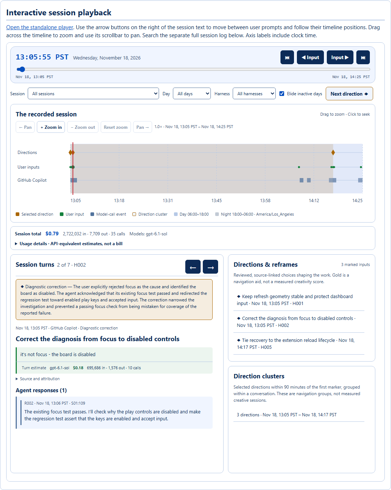

# Agent Session Insights

> **This repository is a fork of [Mark Russinovich's Agent Session Insights](https://github.com/markrussinovich/agent-session-insights).** It retains the original project's session collection, accounting, evidence-linked analysis, report generation and offline player. This fork adds an AgentSON v1.2 interoperability layer and an initial LinkedIn AI/Learning Coach export importer. The goal is to make Agent Session Insights a useful analysis and review application for AgentSON and other exported agent/conversation records, not to replace AgentSON as the canonical interchange format.

> **Beta candidate:** this fork adds AgentSON v1.2 import and verified source-archive export. It is not the upstream PyPI release. See the beta validation workflow and open pull request before relying on it in production.


Create offline reports from coding-agent conversations: complete messages,
evidence-linked analysis, per-model token and cost comparisons, and a zoomable
timeline with local day/night shading. Supports Copilot CLI, Claude Code, Codex,
DeepSeek Harness, Cursor exports, Replit conversation exports, and AgentSON v1.2 archives via explicit manifests.

**See the example:** [HTML report](https://markrussinovich.github.io/agent-session-insights/),
[standalone player](https://markrussinovich.github.io/agent-session-insights/player.html),
or [PDF](https://markrussinovich.github.io/agent-session-insights/report.pdf).



## What this fork is building

The upstream project is an offline session-inspection and reporting application. This fork intentionally retains that purpose and its existing workflows while adding a separate interchange boundary:

- **Retained from upstream:** native session discovery and collection for Copilot CLI, Claude Code, Codex and DeepSeek Harness; explicit Cursor and Replit imports; frozen source evidence; token/accounting and pricing analysis; evidence-linked annotations; HTML/PDF reports; standalone interactive player; manifest-driven preparation and rerendering.
- **Added in this fork:** strict AgentSON v1.2 document/JSONL reading, a privacy-aware reporting projection, private source snapshots with SHA-256 verification, and byte-preserving AgentSON source export.
- **New source adapter:** an initial local LinkedIn AI/Learning Coach CSV importer that converts supported conversation records into AgentSON v1.2 documents.
- **Intended direction:** a growing set of independently tested source adapters that convert exported conversation/session records into AgentSON, followed by the same Agent Session Insights review pipeline.

AgentSON remains the interchange layer; Agent Session Insights remains the analysis, evidence review and presentation application. Importing a source into a report does not make the report's normalized events a lossless replacement for the original source. Where exact preservation matters, the original bytes and their hashes are retained separately.

### What is implemented versus planned

| Capability | Status in this fork |
| --- | --- |
| Original native Copilot, Claude, Codex and DeepSeek Harness workflows | Retained |
| Original explicit Cursor and Replit export workflows | Retained |
| AgentSON v1.2 JSON document and JSONL reader | Implemented; schema-validated |
| Original AgentSON archive byte-preserving export | Implemented; SHA-256 checked |
| LinkedIn AI/Learning Coach CSV-to-AgentSON command | Initial implementation; requires validation against a real member export |
| Every LinkedIn AI/Learning export category and every possible CSV layout | **Not claimed** |
| Universal import of every agent harness or vendor export | **Planned direction, not implemented** |
| Lossless reconstruction of arbitrary source data from normalized report events | **Not supported** |

The LinkedIn importer is deliberately separate from LinkedIn itself: it processes an archive that the account holder has downloaded. It does not log in, scrape LinkedIn, use a Premium API, or unlock categories that LinkedIn did not include in the archive. Premium status does not guarantee that every category is available.

## Install

Use Python 3.12 or later. The PyPI command below installs the upstream MIT Alpha
release and does **not** include this fork's AgentSON integration. To test the
AgentSON beta candidate, clone this fork's feature branch and install it with
`python -m pip install -e .` instead:

```powershell
git clone --branch feat/agentson-v1.2-import-roundtrip https://github.com/andiekobbietks/agent-session-insights.git
Set-Location agent-session-insights
python -m pip install -e .
python -m playwright install chromium
```

For the upstream PyPI package, use Python 3.12 or later and install it with its
Chromium renderer in a virtual environment:

**Windows PowerShell**

```powershell
python -m venv .venv
.\.venv\Scripts\Activate.ps1
python -m pip install agent-session-insights
python -m playwright install chromium
```

**macOS/Linux**

```bash
python3 -m venv .venv
source .venv/bin/activate
python -m pip install agent-session-insights
python -m playwright install chromium
```

On Linux, missing browser system libraries may require
`python -m playwright install --with-deps chromium` and system-install privileges.
Report commands check rendering dependencies before processing sessions or
launching an agent.

The installed `agent-session-insights` command works from any directory.
`python -m agent_session_insights` accepts the same arguments. For a source
checkout, use `python review.py` after installing `requirements.txt`; see the
[maintainer guide](https://github.com/markrussinovich/agent-session-insights/blob/main/MAINTAINING.md#development-setup).
If Windows activation is unavailable, invoke the virtual environment's
`.\.venv\Scripts\python.exe` with the module or checkout entry point directly.

## Generate a report

```powershell
agent-session-insights repo --repo C:\Source\my-project
```

This selects the **newest matching session**, freezes its logs, launches its
native harness headlessly for reviewed annotations, then generates and verifies
the report. The harness CLI must be on `PATH` and signed in; normal model charges
apply. For DeepSeek Harness sessions this runs `dsh headless` with a
`workspace-write` permission preset, so the `dsh` CLI and a working model route
must be available; headless credentials follow that profile's configuration.
Only the selected evidence is reviewed. Use `--noagent` for measured
accounting and replay without qualitative annotations or model calls.

Automatic discovery supports Copilot, Claude, Codex, and DeepSeek Harness. It
matches recorded repository/working-directory metadata in the current user's
native history stores, not project mentions in messages, and excludes native
subagents. Missing or malformed metadata limits discovery; Cursor/Replit require
[explicit exports](#explicit-exports-and-manifests).

Native stores under your home are `.copilot\session-state`, `.claude\projects`,
`.codex\sessions`, `.codex\archived_sessions`, and `.dsh\sessions`. Home-directory
overrides honor `COPILOT_HOME`, `CLAUDE_CONFIG_DIR`, `CODEX_HOME`, and `DSH_HOME`.
DeepSeek Harness sessions are stored as current-format (v4) JSONL, compressed
with Zstandard by default; the adapter reads either representation and refuses
older formats explicitly. Only current-generation session logs for the selected
working directory are read; subagent sessions are excluded. Missing DSH cache
counters stay unknown instead of becoming explicit zeros; without `totalTokens`
they also mark inclusive input incomplete.

### Select sessions

List the matching sessions before choosing:

```powershell
agent-session-insights discover --repo C:\Source\my-project
agent-session-insights repo --repo C:\Source\my-project --session copilot:SESSION_ID
```

Repeat `--session` to combine selected IDs, or use `--all` for every match.
For a combined report, the first selected session's harness reviews the evidence.
`--harness` filters the histories searched; it does not choose a different
reviewer for those histories.

| Option | Purpose |
| --- | --- |
| `--repo PATH` | Required local repository directory. |
| `--session ID` | Select an ID or `harness:ID`; repeat for multiple sessions. |
| `--all` | Combine all matches; mutually exclusive with `--session`. |
| `--harness NAME` | Search only `copilot`, `claude`, `codex`, or `dsh`. |
| `--root PATH` | Override the native history directory; requires `--harness`. |
| `--output PATH` | Override the report destination. |
| `--noagent` | Skip the harness and qualitative annotations. |
| `--logs-only` | Save selected raw logs as `session-logs.zip` in the output directory; no analysis, agent, or report. |
| `--timezone ZONE` | IANA report timezone; default `America/Los_Angeles`. |
| `--pricing PATH` | Override the bundled, dated retail API pricing card. |

For example, combine only Copilot sessions without launching an agent:

```powershell
agent-session-insights repo --repo C:\Source\my-project --harness copilot --all --noagent
```

All commands have `--help` with command-specific examples.

### Gather logs without a review

```powershell
agent-session-insights repo --repo C:\Source\my-project --all --logs-only --output .\collected-logs
```

This writes `.\collected-logs\session-logs.zip` without running analysis, calling
a model, or requiring Chromium/Playwright. The same selection rules apply:
newest matching session by default, repeated `--session` for specific sessions,
or `--all` for every match; `--harness` and `--root` also work.
Omit `--output` to use the normal default destination directory.

The ZIP contains byte-for-byte copies of the selected history files under
`logs`, a `manifest.json` with source hashes, and `discovery.json`. It does not
include auxiliary session files or subagent histories. Extract it and use
`run --manifest` with the extracted manifest to generate a report later.
Report-only `--pricing`, `--timezone`, and `--noagent` do not trigger analysis;
the timezone is saved in the manifest for later use.

Existing destination files are left untouched, and an existing
`session-logs.zip` is refused; choose another output directory or move the
previous ZIP. **Raw logs are not redacted** and may contain credentials,
private conversation text, and local paths. Review before sharing.

## Outputs and safety

The default destination is **`agent-session-reports\<repo-name>` under your
current working directory**, not automatically inside the repository passed to
`--repo`.

Successful report commands print the absolute paths of `report.html`,
`report.pdf`, and `player.html`. Open the HTML files directly; no server is needed:

```powershell
Start-Process .\agent-session-reports\my-project\report.html
```

On macOS, use `open` instead of `Start-Process`. Reports include supporting
accounting, normalized events, coverage, verification, frozen pricing, and
private source snapshots. Repository reports also save `discovery.json` and a
reusable `manifest.json`, plus `annotations.json` when agent-reviewed.

Reports and players share bold blue typography, white light-mode surfaces, and
a navy dark mode. They follow your system theme; embedded replay and log panes
follow the surrounding report. Append `?scoutTheme=light` or `?scoutTheme=dark`
to a report or standalone player URL to override the system preference.

**Overwrite protection:** existing reviews require `Overwrite? [y/N]?`
confirmation; only `y` or `yes` proceeds. An empty answer or closed stdin cancels.
Directories containing unrelated files or selected inputs are refused.
Confirmed replacement removes the previous report before generation, so use a
fresh `--output` directory when you need to retain it if generation fails.

**Privacy:** outputs contain conversation text and private raw snapshots.
Credential and shared-session URL redaction is best effort; review files before
sharing or publishing them. This repository ignores the default report directory;
keep outputs out of version control yourself in other workspaces. POSIX outputs
use directory mode 0700 and file mode 0600. Windows outputs inherit the parent
directory's NTFS ACLs; Python's `chmod` does not set those ACLs.

**Interpretation limits:** retail API-equivalent estimates are not invoices.
Frozen rates may be historical; unknown models or missing total usage are
unpriced, not free. Missing cache counters can produce labeled estimates and
ranges, not verified cache hits. Different workloads and cache use prevent
per-model totals from being an efficiency benchmark. Timeline activity is not
measured working time; day/night shading uses 06:00-18:00 daytime in the report
timezone, not astronomical sunrise/sunset.

A missing or failed harness is an error, not a silent fallback to `--noagent`.
Completion requires verified artifacts and intact snapshots, not merely a zero
harness exit status.

## Advanced workflows

| Command | Input | Result |
| --- | --- | --- |
| `discover` | `--repo PATH`, or `--harness NAME --root PATH` | JSON inventory; no report or agent. |
| `repo` | `--repo PATH` | Complete report with agent review unless opted out. |
| `prepare` | `--manifest FILE --output DIRECTORY` | Frozen evidence and measured analysis; no HTML/PDF/player or agent. |
| `run` | `--manifest FILE --output DIRECTORY` | Complete report using existing annotations if supplied; never launches an agent. |

### Regenerate without another review

Use a report's saved manifest to render its frozen sources, annotations, and
pricing into a different, empty directory:

```powershell
agent-session-insights run --manifest .\agent-session-reports\my-project\manifest.json --output .\rerendered
```

Keep the original directory intact: the manifest references files saved beside
it. This avoids rereading changing live logs or repeating model interpretation.

### AgentSON v1.2 interchange

Agent Session Insights can consume an AgentSON v1.2 archive as an explicitly
selected source. This is an adapter, not a replacement for the AgentSON
canonical format.

The reader accepts either:
- A v1.2 JSON document with an `entries` array and the canonical
  `https://agentson.dev/schema/v1.2.json` schema identifier.
- A v1.2 JSONL stream whose first record is `stream-meta`.

The reader validates inputs against the vendored AgentSON v1.2 JSON Schemas.
Legacy v1/v1.1 documents are rejected with a migration message rather than
silently interpreted as v1.2.

For this fork, install the integration from the checkout (the upstream PyPI
release does not contain this fork-only change until it is released):

```powershell
python -m pip install -e .
```

Create a manifest beside your archive:

```json
{
  "title": "AgentSON session review",
  "timezone": "Europe/London",
  "sources": [
    {
      "harness": "agentson",
      "path": "session.agentson",
      "session": "YOUR_STREAM_ID"
    }
  ]
}
```

Generate the report without launching a model:

```powershell
agent-session-insights run --manifest .\\agentson-review.json --output .\\agentson-review
```

The report projection maps user queries and feedback to user messages,
answers to assistant messages, and actions/observations/handoffs/state events
to tool evidence. Private `thought` entries are retained in the private
byte-for-byte source snapshot but excluded from report events. Session-level
token/cost summaries are not fabricated into per-request usage.

**Lossless archive round-trip:** normalized report events are not a reversible
serialization of AgentSON. The original archive is frozen, SHA-256 verified,
and can be exported byte-for-byte:

```powershell
agentson-export --review-dir .\\agentson-review --source S01 --output .\\roundtrip.agentson
```

The exporter refuses modified snapshots and existing destination files. The
round-trip test asserts exact byte equality and hash verification. This
preserves every original entry, extension field, correlation, provenance
object, and payload even where the reporting projection intentionally omits
data. Review private snapshots before sharing; they may contain sensitive
conversation content or credentials.

### LinkedIn AI/Learning Coach export to AgentSON

The `linkedin-agentson` command is an **initial importer**, not a claim of complete LinkedIn-export compatibility. It accepts a member-downloaded ZIP archive, an extracted directory, or an individual CSV. It looks for known AI/Learning Coach filename patterns, including:

- `guide_messages.csv`
- `learning_coach_messages.csv`
- `LearningCoachMessages.csv`
- `learning_role_play_messages.csv`

The parser recognises common message, sender, conversation-ID, timestamp, question, answer and feedback column aliases. LinkedIn may change filenames, headers, encodings or export structure; the actual archive must be inspected before claiming compatibility with a particular category. Use `--all-csv` to inspect additional CSVs, but unrelated files will be rejected if they do not contain recognised conversation fields.

Install the fork from its feature branch as described under [Install](#install), then run:

```powershell
linkedin-agentson --input .\\Complete_LinkedInDataExport.zip --output .\\linkedin-agentson
```

If the export uses a custom member label, provide it explicitly:

```powershell
linkedin-agentson --input .\\Complete_LinkedInDataExport.zip --output .\\linkedin-agentson --self-sender "Your exact sender label"
```

Alternatively, use `--self-profile-url` when the CSV contains sender profile URLs. If the importer cannot safely distinguish the member from the AI, it must stop rather than silently assign the wrong speaker. Timestamps with an explicit timezone or supported Unix-time values are retained; timezone-naive date strings are rejected rather than assigned an invented timezone.

Each converted conversation becomes a schema-validated AgentSON v1.2 JSON document. Selected source CSVs are also copied byte-for-byte into `private/source-csv`; the AgentSON document records the source path and SHA-256 digest. Keep this output private: it contains personal conversation text. The adapter does not fabricate model usage, tool calls, agent lifecycle events or events absent from the export. Roleplay feedback is represented as observation evidence.

To inspect the resulting conversations with Agent Session Insights, create a manifest that points to one generated `.agentson` file. Replace the example path and session ID with the actual generated filename and ID:

```json
{
  "title": "LinkedIn AI conversation review",
  "timezone": "Europe/London",
  "sources": [
    {
      "harness": "agentson",
      "path": "linkedin-agentson/REPLACE_WITH_GENERATED_FILE.agentson",
      "session": "REPLACE_WITH_GENERATED_SESSION_ID"
    }
  ]
}
```

Then run:

```powershell
agent-session-insights run --manifest .\\linkedin-review.json --output .\\linkedin-review
```

This produces the normal evidence-linked HTML/PDF/player review. It is a reporting projection; the original LinkedIn CSV is retained separately for provenance. Before treating the importer as production-ready, validate it against real exports from the relevant LinkedIn categories and add fixtures for their exact schemas.

LinkedIn's own [data-download instructions](https://www.linkedin.com/help/linkedin/answer/a1339364) explain which categories are available and how to request them. Categories depend on the account and its activity; this project cannot make unavailable categories appear.

### Explicit exports and manifests

Create a JSON manifest for selected history files, including Cursor/Replit
exports. Paths are relative to the manifest:

```json
{
  "title": "Project review",
  "timezone": "America/Los_Angeles",
  "sources": [
    {"harness": "copilot", "path": "logs\\events.jsonl", "session": "session-id"},
    {"harness": "cursor", "path": "chat.md", "session": "export-id"}
  ]
}
```

Each source needs `harness`, `path`, and `session`. Supported harness identifiers
are `copilot`, `claude`, `codex`, `dsh`, `cursor`, and `replit`. Optional source `start`
and `end` values are inclusive, timezone-aware ISO timestamps. Optional
`annotations` and `pricing` paths provide reviewed interpretation and a custom
rate card. Without supplied annotations, `run` labels qualitative interpretation
unavailable.

```powershell
agent-session-insights run --manifest .\review.json --output .\imported-review
```

For manual annotation, use `prepare`, review its stable event IDs and measured
evidence, then create a final manifest referencing the prepared snapshots and
your annotations in the same source order. `prepare` marks interpretation
pending even if its input manifest contains annotations. This staging is
optional; `repo` handles it automatically.

See [collection contracts](DESIGN.md#collection-contracts) for export formats
and scoping, [analysis rules](DESIGN.md#analysis-and-qualitative-review) for
accounting limits, and the [example rate card](examples/pricing-rates.json) for
the pricing schema. No report-time network access is needed for token pricing.

### Interactive reviewer agent

For natural-language selection, use the bundled **agent-session-insights** agent
in this repository's workspace and ask:

> Make a report for `C:\Source\my-project`. I want to pick the sessions.

Unlike the CLI's automatic selection, the agent prompts for unresolved session
choices and the output location. Its profile is
`.github/agents/agent-session-insights.agent.md`; the collect, analyze, and publish
skills are under `.github/skills/`. You can copy those definitions into another
workspace. Installation does not register agents globally or change personal
settings. See [agent contracts](DESIGN.md#agent-contract-and-stages) for the
annotation-only launcher and interactive workflows.

### Rebuild the bundled example

Clone/download this repository, then run from its root:

```powershell
agent-session-insights run --manifest .\examples\creation.json --output .\tmp\creation-review
```

The example uses a scoped, redacted export of the conversation that built this
project, reviewed annotations, and frozen historical prices. Rebuilding it needs
no agent or model call. Offline copies of the
[HTML report](examples/creation/report.html),
[player](examples/creation/player.html), and
[PDF](examples/creation/report.pdf) are also checked in. Download the HTML files
and open them locally; GitHub's file viewer does not run the player.

## Development and publishing

See the [maintainer guide](https://github.com/markrussinovich/agent-session-insights/blob/main/MAINTAINING.md)
for checkout setup, tests, example provenance, GitHub Pages deployment, and PyPI
releases. [DESIGN.md](DESIGN.md) contains collection, accounting, privacy, and
player contracts. The application and this fork's original code are [MIT licensed](LICENSE).
The vendored AgentSON v1.2 JSON Schemas are separately distributed under
[Apache License 2.0](AGENTSON-SCHEMA-LICENSE.txt), with attribution in
[AGENTSON-SCHEMA-NOTICE.md](AGENTSON-SCHEMA-NOTICE.md). Package metadata records
both component licences as `MIT AND Apache-2.0`; this does not relicense the
application as Apache 2.0. See the [changelog](CHANGELOG.md) and [security policy](SECURITY.md).
